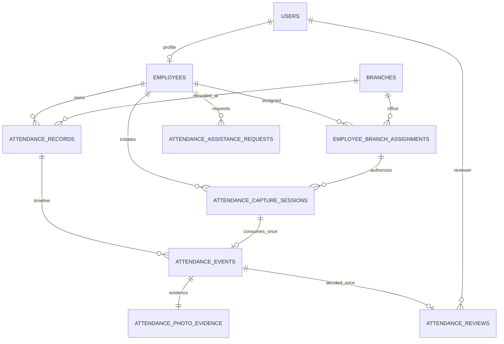

# Attendance database — Phase 4

Migration: `database/migrations/2026_11_12_062140_create_attendance_core_tables.php`. Applied incrementally to the existing MariaDB database; no reset/fresh/wipe was used. Existing Phase 3 data and roles are retained. PHP tests use SQLite memory; browser tests exercise the real local MariaDB schema with isolated synthetic fixtures.

## Tables

| Table | Purpose and important attributes |
| --- | --- |
| `employees` amendment | `attendance_version` increments on submission/review to invalidate stale captures |
| `attendance_records` | Employee/branch, Manila work date, derived accepted Time In/Out UTC, independent session/verification/review statuses, nullable future classification, generated unique `open_employee_id` |
| `attendance_capture_sessions` | UUID, employee/branch/assignment/optional open record FKs, action, hashed token/session binding, attendance version and branch/policy snapshot, expiry/consumed time/request fingerprint |
| `attendance_events` | Immutable original Time In/Out receipt UTC; record/employee/branch/capture links, encrypted location/exception explanation, reported accuracy/distance, original geofence and verification/review statuses, original branch snapshot, privacy purge marker |
| `attendance_photo_evidence` | One per event, private encrypted file reference, original decoded type, normalized MIME/size/dimensions/SHA-256, purge marker; no raw bytes in SQL |
| `attendance_reviews` | One final decision per pending event, reviewer user, approve/reject, required remarks, server review time |
| `attendance_assistance_requests` | Support request only: employee/action, encrypted explanation, pending/resolved/rejected, reviewer/remarks/time; no attendance timestamps |

`audit_logs` is reused. `users` remains linked 1:1 to `employees`; role HR/Employee is not duplicated on attendance. No biometric templates, face vectors, face-match scores or enrollment tables exist.

## Constraints and history

All attendance FKs restrict deletion to preserve history. The record's generated `open_employee_id` is the employee ID for pending/open records and NULL otherwise, with a unique index. This allows many closed sessions, including multiple in a day, but only one active/pending session. The record work date is not globally unique by employee/date.

Each event has one unique capture FK and one photo. Its generated `effective_type` is NULL after rejection, otherwise the original action. Unique `(attendance_record_id, effective_type)` prevents duplicate effective Time In/Out while allowing a fresh checkout after a rejected checkout. The rejected event/photo/review remains accessible until retention removes evidence. Unique review event FK permits a single final decision; no reversal/edit endpoint exists.

Indexes cover employee/work-date, branch/work-date, record-review/work-date, pending-event/time, capture expiry, normalized-image hash and assistance status. FKs index joins. Lists are eager-loaded and paginated. Additional composite indexes should follow production query plans, not speculation.

Business invariants also require locked application logic: active employment, capture ownership, valid current assignment/policy, correct open record, accepted Time In before Time Out, no pending review, and immutable original event facts. Database constraints supplement those checks rather than encoding every business rule.

UTC is the application storage clock; Asia/Manila is the display/work-date zone. Core fields use datetime precision 6 in schema; the current model date serialization stores seconds. UI does not claim subsecond precision. Overnight sessions retain their original work date. Classification remains NULL until separately authorized scheduling work.

## Privacy and maintenance

Detailed location/exception reason use Laravel encrypted casts; image files use authenticated Laravel encryption and randomized paths. Protect/back up `APP_KEY` separately and do not regenerate it during an upgrade. Encryption does not replace authorization. Branch snapshots preserve historical office configuration, not a continuous employee location trail.

`attendance:prune-evidence` removes expired photo files and raw reported coordinates/explanation, then clears paths/marks deletion. It retains event IDs, original timestamps, statuses, distance/accuracy, snapshots, hashes and review decisions. Normal retention is 30 days from the event or later review decision; pending evidence is held at most 90 days. These defaults are proposals, not statutory retention periods. `--orphans` optionally removes unreferenced files older than one hour; ordinary failed transactions clean their staged files immediately. The filesystem and SQL cannot share a transaction; crash or deletion/commit failure needs maintenance reconciliation.

Capture metadata, core attendance, assistance and audit records currently have no automated lifetime deletion. Company-approved schedules, legal holds, request handling and backup expiry must be defined before production. Do not delete referenced employees/branches or use migration rollback to erase real records.
