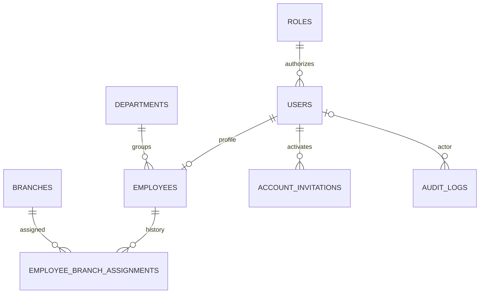

# Implemented Database Schema — Phase 3

Engine: XAMPP **MariaDB 10.11.16**, InnoDB, `utf8mb4_unicode_ci`. Connection: Laravel `mysql` through PDO MySQL. Database: `employee_biometric_db`. UTC timestamps; date-only hire dates. No credentials belong in this document.

## Migration and preservation

Applied migration: `database/migrations/2026_11_12_051823_create_phase_three_administration_tables.php`, batch 2. The three original framework migrations remain unchanged. This migration is additive; the existing login was retained as an active Employee. No account was automatically promoted, deleted or given a new password. No reset/wipe/fresh command was run on the local development DB.

There are now **17 tables**: 9 original framework tables and the 8 added tables below. The final database check confirmed the existing user remained, exactly two role rows existed, and synthetic browser records were cleaned up.

## Extended `users`

Original ID/name/email/password/email_verified_at/remember_token/timestamps remain. Added:

| Column | Constraint/purpose |
| --- | --- |
| `role_id` | Unsigned tiny integer FK to roles, default 2 (Employee), restricted deletion |
| `account_status` | Enum `pending_activation`, `active`, `deactivated`; indexed; new users pending |
| `last_login_at` | Nullable UTC login timestamp |
| `session_version` | Unsigned integer, default 1; revocation check independent of session storage |

Email remains unique and authoritative. Password uses the framework hashed cast. Role/account/session-state fields are not user mass assignable. Existing rows were explicitly retained as active; this backward-compatible migration does not certify their email identity. HR controls later lifecycle operations.

## Added tables

| Table | Columns and constraints |
| --- | --- |
| `roles` | Fixed ID 1/code `hr`, ID 2/code `employee`; primary ID; unique two-value enum code; no mutable role web API |
| `branches` | ID; unique branch_code(30); branch_name(150); address(255), city/province(100); optional postal_code(20); nullable latitude/longitude DECIMAL(10,7); unsigned optional radius; active/inactive enum; timestamps; status index |
| `departments` | ID; unique department_code(30); department_name(150); active/inactive enum; timestamps; company-wide (no branch FK) |
| `employees` | ID; unique user_id FK restricted; unique employee_number(40); first/middle/last names, nullable suffix/contact; department_id FK restricted; position_title(150); date_hired; active/inactive employment enum; timestamps; employment_status/last_name index |
| `employee_branch_assignments` | ID; employee/branch FKs restricted; primary flag; microsecond from/until datetimes; stored generated current_employee_id; unique current index; branch_id/effective_until index; timestamps |
| `account_invitations` | ID; user FK restricted; unique SHA-256 token_hash CHAR(64); expiry index; nullable used/revoked timestamps; controlled delivery_status; timestamps; user/use/revocation index |
| `audit_logs` | ID; nullable actor_user_id FK restricted; action index; subject_type/subject_id; safe JSON metadata; bounded IP/user-agent; created_at index; no web update/delete routes |
| `local_mail_messages` | ID; recipient email SHA-256 hash index; encrypted JSON body in TEXT payload; created_at; expires_at index; hidden body serialization; local-only protected preview |

`employees.work_email` is an accessor through `user.email`, not a duplicated column. Employee full name is derived from name parts and synchronized to the user's display name by HR edits. A User has an optional unique employee profile; an HR account can therefore participate in future employee self-service without a second login or role.

## Relationship diagram



Audit subject IDs are intentionally descriptive references, not polymorphic cascades. Local preview bodies are encrypted and short-lived, not an authoritative invitation table; recipient hashes support targeted cleanup without storing a second plaintext recipient column.

## Assignment uniqueness and transaction rules

`current_employee_id` is computed as:

```sql
CASE WHEN effective_until IS NULL AND is_primary = 1
THEN employee_id ELSE NULL END
```

The unique index `one_current_primary_per_employee` allows many closed historical rows but at most one open primary per employee. MariaDB schema inspection verified it is a stored generated column with a unique BTREE. This avoids pretending a nullable composite index or PostgreSQL partial index provides the same guarantee.

All administrative writes lock the HR role row, reauthorize the current actor, then apply bounded transactions. Activation takes the same lock and rechecks its invitation/user rows. Last-active-HR protection, active reference checks and transfer/status races therefore share one serialization boundary. Delivery occurs after commit and does not hold DB locks.

## Audit and sensitive-data lifecycle

Audit records include creation, updates, transfers, employee/HR status changes, invitation issuance/revocation/delivery failure and activation. Change metadata is limited to field names, related IDs and non-sensitive state. Passwords, raw tokens and contact values are excluded. The application exposes no ordinary audit modification endpoint; database-owner access and external tamper-evident copies are production operational concerns.

Raw invitation tokens are absent from the invitation table; local mail stores recoverable tokens only inside encrypted preview payloads. The private inbox is restricted to reauthenticated HR in local mode. Expired previews are inaccessible and pruned with the scheduled cleanup command; configure scheduler execution to purge at rest. Hashes/audit/employee retention needs company/DPO policy and is not an invented indefinite retention commitment.

Sessions/reset tokens are revoked on relevant account changes. Invitation issuance/activation and email replacement clear stale reset tokens. No cascade deletes erase employment or assignment history through ordinary endpoints.

## Verification and scope

SQLite feature tests cover actual queries, constraints, relationships, rollback and lifecycle behavior in isolation. Real MariaDB migration, column/index/FK inspection and browser CRUD/activation/session checks were also performed. This is not a claim of load or concurrent multi-process stress testing.

Phase 4 adds six attendance/evidence/review/support tables and employee attendance version; see [ATTENDANCE_DATABASE.md](ATTENDANCE_DATABASE.md) for the migration, relationships, constraints and privacy lifecycle. Branch coordinates now drive real attendance geofencing. No schedule, leave, payroll or biometric-reference/template tables exist. The existing local database name is retained for compatibility; its legacy name does not imply facial processing.
