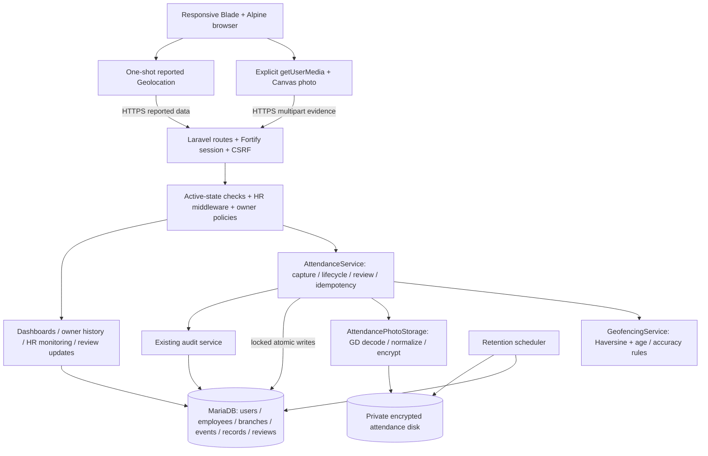

# System Development Blueprint

**Title:** BranchSync: Web-Based Employee Attendance and Management System with Live Camera Photo Capture and GPS Geofencing

**Baseline:** 2026-11-12, updated through Phase 4

**Owners:** Company sponsor, HR, IT/security and Data Protection Officer (named owners to confirm)

The explicit Phase 3 instruction established exactly HR and Employee roles. Phase 4 removed facial recognition, biometric enrollment, face matching and liveness from the entire architecture. This current blueprint supersedes conflicting original proposals; old phase reports remain historical records.

## 1. Executive summary

BranchSync centralizes employee administration and attendance across approximately 27 offices through a responsive website. Employees sign in, capture a live browser camera photo, and submit a reported location when recording Time In or Time Out. Laravel checks authorization, branch assignment, geofence policy, image and transaction state and records authoritative server time. HR monitors all branches and reviews eligible exceptions. Camera/GPS evidence cannot independently attest physical presence.

## 2. Problem and solution

Scattered attendance sheets and disconnected office records make timely monitoring, consistent employee administration and correction review difficult. A shared Laravel application maintains employees/branches/departments, records traceable attendance events, protects photo/location evidence, and separates normal location validation from explicit HR exception decisions. Historical facts remain available without silently rewriting timestamps or failed geofence outcomes.

## 3. Objectives

1. Give HR a consistent company-wide employee and attendance workspace.
2. Provide fast, accessible mobile attendance with clear camera/location permissions and feedback.
3. Use server decisions/time and concurrency-safe writes rather than trusting client success flags.
4. Restrict employees to their own records; make review decisions traceable.
5. Protect private evidence and minimize collection/retention.
6. Build maintainable modules that can later support confirmed schedules, corrections, leave and reports.

## 4. Technology

The existing PHP 8.5/Laravel 13/Fortify/Blade/Tailwind 4/Alpine 3/MariaDB application is retained. Camera uses MediaDevices/Canvas; location uses Geolocation and a PHP Haversine module. GD validates/normalizes images. No biometric service, paid map, new package or SPA is needed. [Exact installed versions and decisions](TECH_STACK.md).

## 5. Modules and current state

| Module | Current state |
| --- | --- |
| Authentication/account lifecycle | Login/logout, HR invitations/activation, recovery controls and session revocation implemented |
| Authorization | Exactly HR/Employee; backend HR middleware and owner policies implemented |
| Employees/branches/departments | Registration/edit/status, searchable listings and historical primary assignment implemented |
| Live camera | Explicit preview/capture/retake/switch/cleanup and no gallery control implemented |
| GPS/geofence | One-shot reported location, server distance/age/accuracy/branch checks implemented |
| Attendance | Real server Time In/Out, overnight/open session integrity, retries and protected evidence implemented |
| HR review | Pending exceptions, approve/reject/remarks/audit, no self-review implemented |
| Assistance | Support queue/disposition implemented; creates no missing/corrected punch |
| Dashboard/updates | Real statistics and refresh-based review updates implemented |
| Privacy maintenance | Encrypted private evidence and bounded photo/location pruning implemented; company policies pending |
| Scheduling/corrections | Deferred pending confirmed rules and explicit next instruction |
| Leave | Deferred |
| Formal reports/exports | Deferred; current monitoring filters are functional |
| Production operations | Deployment, physical-device pilot, capacity/security/restore verification pending |

Functional acceptance and non-functional requirements are maintained in [REQUIREMENTS.md](REQUIREMENTS.md), not inferred from placeholder buttons.

## 6. Roles and permissions

| Capability | Employee | HR |
| --- | --- | --- |
| Personal attendance/profile/history/photos | Own linked eligible profile | Own linked eligible profile with same login |
| Employee/master-data/account management | Denied | Company-wide |
| Company attendance/photos/reported coordinates | Denied | Company-wide |
| Review pending exceptions | Denied | Another HR reviews own attendance; remarks/confirmation required |
| Edit original attendance time/photo/GPS | Denied | No application endpoint |
| Audit access | Denied | Company-wide |

No Admin/Super Admin/Sub-Admin or branch-scoped staff roles exist. Hiding UI is not authorization. [Detailed permissions](RBAC_PERMISSIONS.md).

## 7. Architecture



There is one maintainable Laravel application, not a microservice network. JSON endpoints serve the same-origin attendance component; standard Blade forms handle HR review. Browser identity, verification results and punch timestamps are never authoritative. Secrets remain in server configuration. No third-party facial service is contacted.

## 8. Laravel structure

```text
app/
  Actions/Fortify/             Existing authentication actions
  Http/Controllers/           Employee capture/history/evidence/dashboard
  Http/Controllers/HR/        Master data, attendance monitoring/review, audit
  Http/Middleware/            HR/active-account/security headers
  Http/Requests/              Validated employee and attendance input
  Models/                    Users, employees, branch history and attendance entities
  Policies/                  Employee and attendance owner/HR rules
  Services/                  Attendance lifecycle, geofence, photos, queries, audit
  Console/Commands/          Private-mail and attendance evidence maintenance
config/attendance.php         Configurable development policy
database/migrations/          Incremental relational schema
database/factories/           Synthetic test data
resources/views/attendance/   Capture, history/monitoring, details and updates
resources/js/attendance.js    Camera/location/component lifecycle
resources/views/components/  Shared accessible Blade controls
routes/web.php               Authenticated web/JSON endpoints
routes/console.php           Retention scheduling
storage/app/private/attendance/ Encrypted evidence; never public or committed
tests/Feature/                Business/HTTP/authorization regression checks
tests/Unit/                   Pure geographic distance/policy checks
tests/Browser/                Existing Edge automation and isolated MariaDB fixtures
docs/                        Architecture, workflows, security and test evidence
```

## 9. Database and relationships

Implemented master data: users → optional employee; employee → department and historical branch assignments; branches → assignments. Roles contain exactly HR and Employee. Existing invitations, sessions, local mail and audit entities are reused.

Attendance records belong to employees/branches and contain derived accepted Time In/Out. Events preserve original receipt time, branch snapshot, geofence outcome and protected reported location. Each event consumes one capture, has one photo reference and at most one HR decision. Assistance is a separate support record. Unique active-employee/effective-action constraints and restricted FKs preserve lifecycle/history. [Schema, relationships, constraints and indexes](ATTENDANCE_DATABASE.md).

Future scheduling, correction and leave tables must be designed only after their company requirements are confirmed. Do not create the original suggested schema blindly.

## 10. Account readiness (replaces biometric enrollment)

There is no biometric enrollment. HR registers an employee, assigns an active branch/department and sends activation. The employee chooses a private password through the expiring invitation; no shared or generated disclosed employee password exists. HR verifies branch coordinates/radius and explains the notice/exception path before real attendance. An HR login may use personal attendance only if linked to an eligible employee profile.

## 11. Time In/Time Out and geofence workflows

Time In: active account/profile/assignment → capture session → fresh reported GPS → server preview → explicit live camera → capture/retake → backend validation → transactional event/photo linkage and authoritative receipt time → confirmation after commit.

Time Out repeats capture/GPS validation and attaches to the accepted open Time In across midnight. Duplicates, stale tokens, changed assignments and pending decisions block conflicting actions. Invalid photo/identity/session requests create no punch. Eligible valid-photo exceptions require explicit employee request and remain pending HR review. Approval preserves original time/GPS and is labelled exception approved. [Full workflow](ATTENDANCE_WORKFLOW.md), [camera](CAMERA_IMPLEMENTATION.md), [geofence](GPS_GEOFENCING.md).

## 12. Future leave workflow

Planned only: employee submits approved leave type/dates and required private document → backend validates ownership/overlap/company policy → HR other than requester reviews → immutable decision/history → employee update → schedule/attendance reconciliation preserving events. Leave balances, partial days, cancellation/delegation and document retention need HR confirmation. No leave functionality is simulated as working.

## 13. Security and privacy

Preserve Fortify password/session controls, CSRF, backend authorization, validation, escaped views, parameterized queries, no public registration, account revocation, rate limiting and audited actions. Protect photo/location data through private authorized access and encryption. Use UTC server time, unique constraints, token bindings and immutable original event facts. See [implemented controls and residual risks](ATTENDANCE_SECURITY.md).

Before real employee collection, the DPO/company must approve lawful basis, purpose/necessity, notices, PIA, accessible alternatives, review SLA and differentiated retention/backup/rights/incident processes. The 30/90-day evidence defaults are development proposals, not legal periods. Browser permissions are not legal consent. No compliance certification is claimed. [NPC Data Privacy Act](https://privacy.gov.ph/data-privacy-act/).

## 14. UI/UX

Light corporate design with desktop sidebar, mobile drawer, reusable form/alert/state/table controls, keyboard focus/labels, server-confirmed feedback and empty/loading states. Attendance is a dedicated mobile flow with large Time In/Out controls, whole-frame preview, retake/switch/cancel, location status/retry and explicit exception explanation. No passive camera, file selection or background tracking. Tables scroll within their container; layouts are checked at 320 through 1440 widths. Physical-device/browser checks remain required.

## 15. MVP and later enhancements

Implemented increments cover account/master data and core attendance. A production MVP still needs confirmed scheduling/corrections, leave/report requirements and operational/privacy gates. Payroll, advanced analytics, external notifications, paid maps/integrations, off-site mode and offline/native clients require separate approval. Facial recognition is outside the approved design entirely.

## 16. Challenges and responses

| Challenge | Approach / remaining work |
| --- | --- |
| Indoor/inaccurate/spoofed GPS | Accuracy/uncertainty policy, retry and explicit HR review; branch trials still needed |
| Unattested camera origin | Live UI, capture binding, repeat signal and manual review; no identity/presence guarantee |
| Double clicks/network loss | Unique constraints, atomic consume, immutable request retries and status lookup |
| Overnight/incomplete sessions | Keep original open record/work date; no automatic absence or fabricated checkout |
| Account/branch changes racing punches | Shared administrative mutex and fresh state/version checks; peak-load test before scale |
| Evidence privacy/storage growth | Encryption/access restrictions, bounded pruning, policy approval and storage reconciliation |
| Mobile API/HTTPS variation | Secure-context guidance and explicit errors; real-device checklist required |
| 27-branch peak arrivals | Image compression, pagination/indexes, short commits; measure before introducing infrastructure |

## 17. Roadmap and confirmations

[Development roadmap](DEVELOPMENT_ROADMAP.md) records completed Phases 1–4 and proposed scheduling/corrections, leave, reports and production pilot phases. [Company confirmation register](REQUIREMENTS.md) covers branch/policy/device/retention/hosting/approval questions. No next phase, public deployment or optional integration is authorized by this blueprint. Stop after Phase 4 and await the next instruction.
