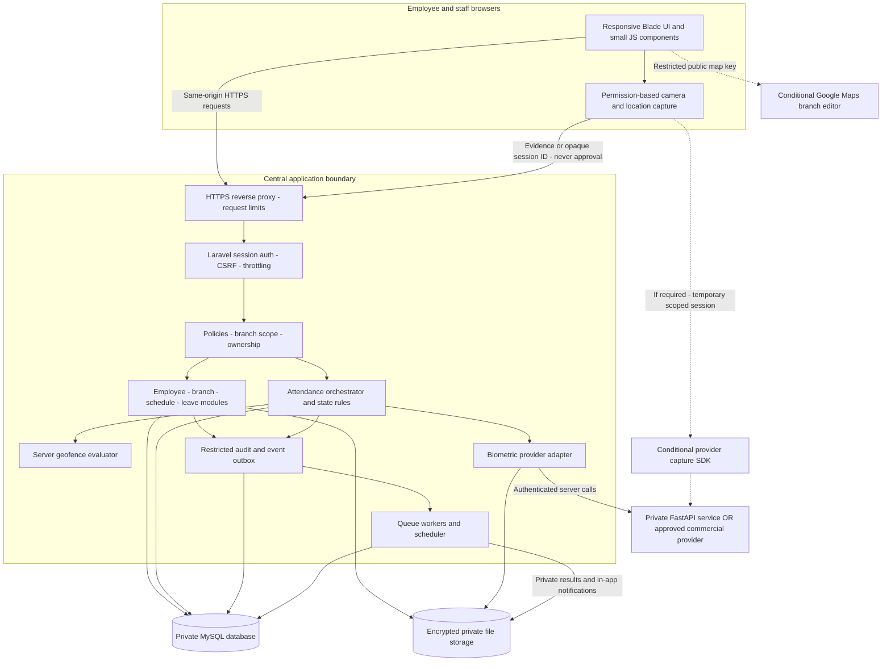
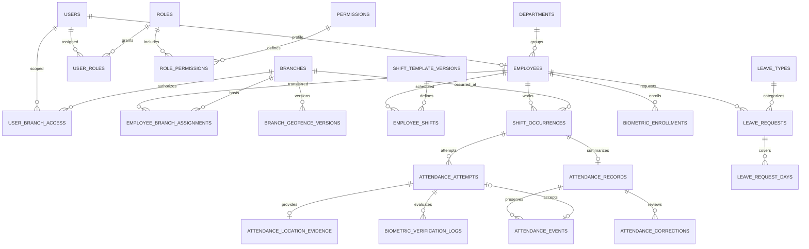
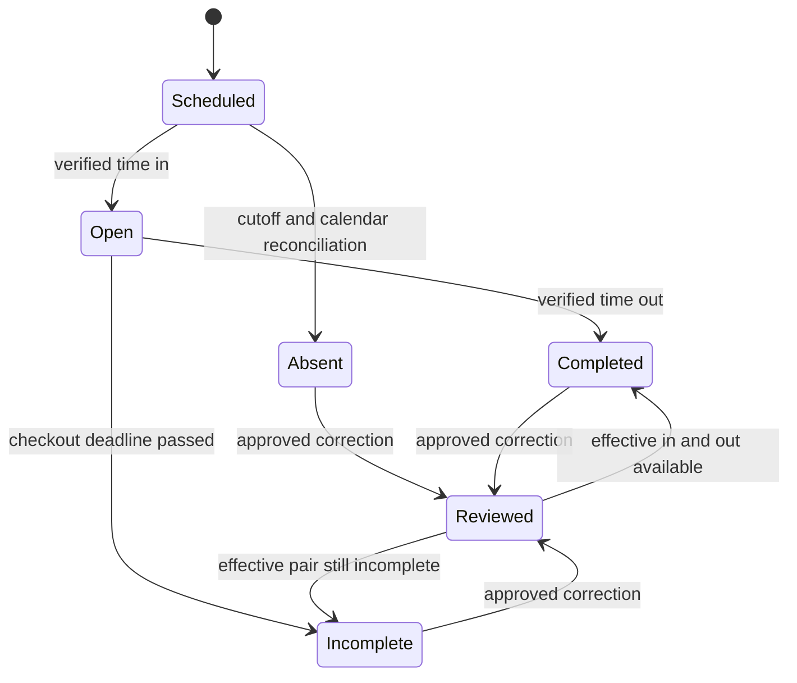

# System Development Blueprint

**Proposed final title:** BranchSync: Web-Based Employee Biometric Attendance and Management System with Facial Verification and GPS Geofencing  
**Planning date:** 2026-11-12 (Asia/Singapore)  
**Status:** Phase 1 documentation complete; proposals await company confirmation. No application implementation.  
**Scope owner:** Company sponsor with HR, IT/security, and Data Protection Officer (DPO). Named owners to be confirmed.

## Document guide

- [Technology Stack](TECH_STACK.md): version recommendations, architecture decisions, biometric options, and integration boundaries.
- [Requirements](REQUIREMENTS.md): functional/non-functional acceptance baseline, permission matrix, scope, and company confirmation register.
- [Development Roadmap](DEVELOPMENT_ROADMAP.md): sequential phases, dependencies, deliverables, tests, and exit gates.

This blueprint is a design proposal, not a claim that the current repository implements its controls. The existing root `index.php` is an unchanged login UI prototype. Phase 1 creates documentation only. Do not initialize Laravel, install packages, create tables, or proceed to Phase 2 until requested.

## 1. Executive summary

BranchSync will centralize employee administration and attendance across approximately 27 company branches. Employees will sign in through a responsive website, verify their identity against their own enrolled facial reference, and submit location evidence when recording time-in or time-out. Laravel will decide whether a submission meets company policy and save the authoritative attendance result.

HR and authorized administrators will manage employees, effective-dated branch/schedule assignments, leave, corrections, and reports within their permitted scope. Security, accessibility, operational recovery, and employee privacy are release requirements. Facial and location evidence reduce certain fraud risks but cannot guarantee physical presence or eliminate all spoofing.

## 2. Problem statement and proposed solution

Distributed offices need consistent records, visibility, and approval rules. Disconnected logs can cause duplicates, delayed reporting, identity uncertainty, inconsistent absence decisions, and difficult corrections. Location-only attendance is vulnerable to inaccurate/manipulated readings. A camera preview alone does not verify identity. Centralization also increases the consequences of unauthorized access or biometric disclosure.

Use a modular Laravel application backed by a transactional relational database. Separate camera capture from actual biometric verification, enforce access on every server operation, and retain historical assignment/policy context. Provide explicit retry and human-review paths when verification or connectivity fails. Avoid unreviewed automated disciplinary or payroll decisions.

## 3. Main objectives

1. Provide consistent attendance and employee management for all authorized branches.
2. Verify the signed-in employee using evaluated one-to-one facial matching and liveness/PAD.
3. Evaluate fresh location evidence against authorized, versioned branch geofences.
4. Prevent duplicate/replayed attendance while preserving reliable server timestamps.
5. Support schedules, overnight shifts, leave, incomplete attendance, and audited corrections.
6. Restrict access by permission, branch, and ownership, including reports and attachments.
7. Deliver usable desktop/mobile browser workflows and accessible alternatives.
8. Protect employee information through minimization, encryption, controlled retention, and tested recovery.

Success measures and proposed service targets are in [Requirements section 4](REQUIREMENTS.md#4-non-functional-requirements); numerical targets require company agreement and measurement.

## 4. Recommended technology and architecture

Use Laravel 13.x, patched PHP 8.5.x after compatibility checks, Blade, Tailwind 4, selective Alpine.js, Vite, and MySQL 8.4/InnoDB. Composer and Node/npm support builds; Git/GitHub support review and CI. XAMPP is local tooling, with its actual MariaDB/MySQL engine verified before schema work. Full justification and supported-version sources are in [TECH_STACK.md](TECH_STACK.md).

Start with a **modular monolith**: one Laravel application with separate services for attendance, geofencing, enrollment, leave, reporting, and audit. Keep biometric processing behind an adapter to a private Python/FastAPI service or approved commercial provider. This provides a clear trust boundary without distributing every business module into a separate service.

The commercial evaluation candidate is AWS Face Liveness plus CompareFaces; a licensed self-hosted model plus independently evaluated PAD is the alternative. Provider selection, thresholds, licensing, processing terms, and browser capture compatibility remain gated. A vendor SDK may require a small React capture component; this proposed exception is explained before implementation in the stack document.

### Architecture diagram



Solid paths are core communication; dotted paths are conditional integrations. Provider choice is exclusive for the first deployment, not a requirement to operate both.

### Browser/backend/service contract

- Same-origin authenticated HTTPS requests carry Laravel CSRF protection and an employee/action-bound attempt ID. Secure, HttpOnly session cookies are not stored in JavaScript.
- Laravel derives employee identity, allowed branch, and shift. Browser employee IDs, timestamps, scores, radii, and success flags cannot authorize attendance.
- Camera capture sends bounded multipart evidence, or a provider session identifier. Temporary SDK credentials, if needed, are session-scoped; permanent service credentials remain server-side.
- Laravel retrieves the provider result and checks subject, reference version, request/session ID, expiry, quality, matching, PAD, and policy version. A client callback is only a completion hint.
- A private FastAPI service has no public browser endpoint or attendance-write permission. Use private networking, authenticated TLS calls, input limits, redacted logs, and bounded timeouts.
- Browser camera/location need permission and secure contexts. Stop video tracks after use and when the page exits. Test phone HTTPS access rather than assuming HTTP LAN development works. [MDN camera guidance](https://developer.mozilla.org/en-US/docs/Web/API/MediaDevices/getUserMedia)

### Capacity and concurrency

Size from employee count, arrival-window concentration, verification duration, and provider quotas. For `N` punches in `W` seconds, baseline arrival rate is `N/W`; test burst and retry multipliers. Twenty-seven branches alone is not a capacity estimate.

Use bounded uploads, connection pooling where supported, indexed scoped queries, pagination, report limits, and asynchronous exports. Start with database-backed jobs/sessions if measured load permits; move queues/cache to Redis when justified. Shared sessions/storage are required before multiple app instances. Keep biometric inference independently scalable, preload models, and measure worker memory before adding processes.

Do not hold database row locks during camera interaction or a provider network call. Record pending attempts, verify outside the short commit transaction, then lock/recheck/commit. Use an outbox or transactional job dispatch to avoid notifications about rolled-back attendance.

## 5. Modules, functional and non-functional requirements

| Module | Included responsibility |
| --- | --- |
| Authentication/account lifecycle | Login/logout, activation, reset/recovery, sessions, deactivation, privileged MFA proposal |
| Access control | Roles, permissions, explicit branch grants, ownership checks, administrative restrictions |
| Employee/department management | Profiles, search/filter, department, effective branch and schedule assignments, status |
| Branch management | Directory, scoped staff grants, versioned coordinates/radii, authorized branch assignment |
| Schedule/calendar management | Shift templates/occurrences, overnight rules, rest days and holiday calendar needed for absence |
| Biometric enrollment | Authorized identity confirmation, notices, quality/PAD, active reference version, revocation/deletion |
| Facial attendance verification | Camera lifecycle, provider integration, one-to-one matching/PAD, failures and restricted logs |
| Geofencing | Fresh location evidence, accuracy and distance evaluation, boundary/retry/review outcomes |
| Attendance | In/out state machine, server timestamps, history, classification, duplicate protection |
| Corrections | Employee requests, evidence, scoped review, immutable original facts, recalculation |
| Leave | Types, dates, protected documents, scoped approval/rejection, history and attendance reconciliation |
| Dashboards | Scoped counts, queues, employee status and action cards using real data |
| Reports | Daily/weekly/monthly, employee/branch, late/absent, leave and corrections; basic CSV |
| Notifications | In-app workflow and security notices; security recovery delivery handled separately |
| Audit/privacy/operations | Sensitive-action audit, rights requests, retention/deletion, backup/restore and monitoring |

The complete functional acceptance catalogue is [Requirements section 2](REQUIREMENTS.md#2-functional-requirements). Non-functional requirements cover security, privacy, responsiveness/accessibility, maintainability, consistency, performance, observability, availability, and recovery. Acceptance includes negative tests, not only successful UI clicks.

## 6. Roles and authorization

The full [permissions matrix](REQUIREMENTS.md#3-role-and-permissions-matrix) is authoritative for the proposal. Admin/Super Admin administers company-wide settings; Sub-Admin receives selected functions and branches; HR operates within assigned scope; Employee accesses personal records and actions.

Access evaluation is: active account + required permission + allowed branch/ownership + valid workflow state. Enrollment and audit access require distinct permissions. No normal role has a biometric-reference download screen. Prevent self-approval and self-granted administrative access. Do not introduce a separate Branch Manager role without company confirmation; scoped Sub-Admin permissions cover that need initially.

Historical employee access needs explicit policy: proposed default is attendance access by the branch stored on the historical shift, current profile access by current assignment, with personal access preserved for the employee. Sensitive medical attachments need narrower access than general leave lists. Global scope must be explicit, never inferred from an empty branch list.

## 7. Recommended future Laravel folder structure

This is a proposed tree only; Phase 1 does not create it. Existing Laravel conventions remain intact.

```text
app/
  Contracts/Biometrics/       # Provider-neutral enrollment/verification interfaces
  Http/
    Controllers/             # Auth, employee, HR, admin and attendance endpoints
    Requests/                # Input validation and request authorization
    Middleware/              # Active-account and request correlation checks
  Models/                    # Eloquent entities and scoped query helpers
  Policies/                  # Permission, branch, ownership and workflow checks
  Services/
    Attendance/              # Attempt lifecycle, commit, classification, corrections
    Biometrics/              # Enrollment and selected provider adapter
    Geofencing/              # Distance and uncertainty evaluation
    Employees/               # Effective-dated assignment changes
    Leave/                   # Submission, review and reconciliation
    Reporting/               # Shared scoped report queries
    Audit/                   # Redacted structured business/security audit
    Privacy/                 # Retention, deletion and rights processing
  Jobs/                      # Exports, notifications, cleanup and reconciliation
  Notifications/             # Minimal recipient-safe in-app messages
  Events/                    # Business events emitted after commit
  Listeners/                 # Notification and audit reactions
  Enums/                     # Typed states and reason codes
config/                      # Attendance/privacy settings; secrets via environment
database/
  migrations/                # Ordered schema changes, constraints and indexes
  seeders/                   # Permissions, approved defaults, synthetic local data
  factories/                 # Synthetic test fixtures
resources/
  views/
    layouts/                 # Authenticated, guest and employee layouts
    components/              # Fields, buttons, tables, dialogs, alerts and cards
    auth/ admin/ hr/ employee/
  css/app.css
  js/                        # Camera, location, attendance state and Alpine modules
routes/web.php               # Same-origin session-protected browser routes
routes/console.php           # Scheduled tasks where appropriate
routes/api.php               # Only if a separate REST API is justified
storage/app/private/         # Development private files; production private disk
tests/
  Unit/                      # Distance, state transitions and classification
  Feature/                   # Authorization, workflows, uploads and lifecycle
  Integration/               # Real MySQL concurrency and provider contract tests
docs/                        # Blueprint, decisions, rollout and operations records
public/                      # Only public web root; no .env or private evidence
```

Controllers coordinate HTTP input/output; services own business rules; policies own access decisions; jobs perform deferred work. Avoid adding repository abstractions or a module package solely for folder organization. Python service, if selected, gets a separate maintained service project and deployment contract during its phase.

## 8. Preliminary relational database design

### Conventions and lifecycle

Use internal bigint primary keys, opaque public IDs for sensitive routes where useful, InnoDB, utf8mb4, UTC `DATETIME(6)` timestamps and deliberate date-only fields. IDs are never authorization. Money is outside scope. Durations use integer minutes/seconds; coordinates use validated decimal latitude/longitude, not strings.

All tables use explicit foreign keys where practical. Restrict deletion of referenced employees, branches, shifts, and audit subjects until approved retention/pseudonymization processing. Cascade only disposable pivots/tokens, not attendance history. Soft deletion is an operational convenience, not biometric erasure. Keep login credentials in users and HR profile data in employees.

### Tables and principal fields

| Table/group | Principal fields and relationships | Constraints / history |
| --- | --- | --- |
| `users` | id, public_id, normalized email, password hash, state, activated_at, session_version | Unique email/public_id; no plaintext password; inactive checked on every action |
| `employees` | id, user_id, employee_number, name, department_id, employment dates/status | Unique user_id and employee_number; user may be admin without employee profile |
| `roles`, `permissions` | stable code, display name, protected/system flag | Unique codes; protect essential administrative capabilities |
| `role_permissions`, `user_roles` | role_id/permission_id and user_id/role_id | Composite unique pairs; audit grant changes |
| `user_branch_access` | user_id, branch_id, grantor_id, effective_from/to | Explicit staff scope, separate from employee work assignment; overlap rules |
| `branches` | code, name, address, timezone, status | Unique code; archive rather than silently relabel history |
| `branch_geofence_versions` | branch_id, latitude DECIMAL(10,7), longitude DECIMAL(10,7), radius_m, accuracy_limit_m, effective_from/to, actor | Immutable versions; coordinate ranges, positive radius, no overlapping effective versions |
| `departments` | code, name, status | Company-wide initially; branch-specific departments only if confirmed |
| `employee_branch_assignments` | employee_id, branch_id, effective_from/to, actor | Proposed one primary assignment at an instant; preserve transfers |
| `shift_templates`, `shift_template_versions` | template code; versioned local times, overnight offset, grace/window/rule version | Version changes do not rewrite previous occurrences |
| `employee_shifts` | employee_id, template_version_id, effective_from/to, recurrence | Assignment overlap validated; occurrence generation idempotent |
| `shift_occurrences` | employee_id, assignment_id, branch_id, local_work_date, start/end UTC, timezone, rule snapshot, state | Unique employee + planned start in initial model; supports overnight without date uniqueness assumption |
| `calendar_days` | branch_id, local date, rest/holiday/workday override, rule | Unique branch/date; inputs for absence and leave reconciliation |
| `biometric_enrollments` | employee_id, version, provider/model, encrypted reference object/key, key_version, status, enrolled_by, notice/basis reference, revoked_at, delete_after | Unique employee/version; active reference controlled by employee lock/pointer; reference never public |
| `attendance_attempts` | employee_id, shift_occurrence_id, action, idempotency_key, challenge digest, expiry, server_received_at, state, enrollment/geofence/policy versions | Unique employee + idempotency_key; binds action/session/subject; request payload digest prevents key reuse with different content |
| `attendance_location_evidence` | attempt_id, encrypted coordinates, accuracy_m, reported acquisition time, server receipt time, retention deadline | Unique attempt_id; client timestamp advisory; restricted short-retention evidence |
| `biometric_verification_logs` | attempt_id or enrollment operation, enrollment_id, provider request ID, model/PAD versions, restricted scores, result/reason, duration | No raw images/template in logs; unique provider request binding; enrollment/attendance context checked |
| `attendance_events` | record_id, attempt_id, type, accepted server timestamp, branch/geofence/enrollment versions, source, correction_id | Append-only accepted facts; unique attempt_id; raw punch types separated from correction adjustments |
| `attendance_records` | employee_id, shift_occurrence_id, effective in/out event references/times, status, rule version, row version | Unique shift_occurrence_id; derived projection, not sole evidence; original events remain |
| `attendance_corrections` | record_id, requester, requested in/out, reason, state, reviewer, decision/reason, row version | No self-approval; only authorized pending transition; approved requested time explicitly marked human-corrected |
| `leave_types` | code, name, active, document/partial-day policy | Unique code; balance/accrual engine deferred unless confirmed |
| `leave_requests`, `leave_request_days` | employee, type, date range, reason, state, reviewer; per-local-date portion/minutes | Validate overlap under employee lock; explicit schedule/calendar interpretation |
| `private_attachments` | owning leave/correction, uploader, storage key, MIME, size/hash, scan state, delete_after | Exactly one permitted owner relationship; no public path; authorized downloads |
| `notifications` | Laravel database notification shape, recipient, type, minimal data, read_at | Recipient/time index; no biometric/medical payloads |
| `audit_logs` | actor, action, subject IDs, branch, redacted changes, result, correlation_id, occurred_at | Append-only application access; external restricted copy for tamper evidence; retention managed |
| `system_settings`, `policy_versions` | typed allowlisted setting/value, immutable effective rule versions, actor | No secrets; unique setting key; audit and validate changes |
| `privacy_notice_versions`, `privacy_acknowledgments` | notice version, employee, shown/acknowledged time, purpose/basis record | Acknowledgment is not automatically legal consent; withdrawal handled if consent is the basis |
| `privacy_requests`, `data_deletion_tasks` | subject, request type/state, verified requester, due date, reviewer; provider/storage deletion tasks | Restricted access; deletion retries and minimum proof, no retained template copies |
| `outbox_events` | event ID/type, minimal payload, commit time, dispatched_at | Unique ID; idempotent workers; do not duplicate sensitive evidence |
| Framework support tables | sessions, password_reset_tokens, jobs, failed_jobs, job_batches/cache if selected | Use conventional migrations; prune tokens/sessions/jobs and redact payloads |

Versioned policy snapshots contain the historical branch label/code and relevant rule inputs where necessary for reports. Preserve a stable department/assignment reference or snapshot if historical department reporting is required. Avoid indiscriminate JSON snapshots of complete employee profiles.

### Relationship diagram



Diagram shows core relationships, not every operational table. Optional employment states and foreign-key nullability must be finalized in migrations after confirmation.

### Constraints, indexes, and race safety

- Index attendance records by `(employee_id, shift_occurrence_id)` and occurrences by `(branch_id, local_work_date, employee_id)`; scope/date filters should lead reporting indexes. Add state/date indexes for pending approvals and cleanup deadlines.
- Add unique attempt idempotency keys and unique accepted raw in/out action per record, using a dedicated nullable punch discriminator or equivalent validated database design. Correction events must not collide with raw punch uniqueness.
- MySQL cannot be treated as having PostgreSQL partial/exclusion indexes. Enforce active-reference/effective-period rules with a locked parent row, explicit active pointer or supported generated-column uniqueness, and tested transactions. Naive nullable composite indexes do not ensure one active row.
- Under a short employee/occurrence lock, recheck current record, assignment, account status, challenge expiry, consumed state, provider result, and reference/geofence versions. Concurrent changes invalidate/restart the attempt rather than applying a silent new policy.
- Use a consistent lock order and bounded deadlock retries. Same idempotency key with different content is a conflict, not a second request. Timestamp ordering must reject time-out before effective time-in.
- Leave overlap, assignment periods, and competing approvals need transactions plus version checks; foreign keys alone cannot enforce them.
- Do not run MySQL locking tests solely against SQLite. [MySQL locking reads](https://dev.mysql.com/doc/refman/8.4/en/innodb-locking-reads.html)

## 9. Authorized biometric enrollment workflow

1. Authorized HR confirms employee identity using the company-approved process and checks account/employment status and branch scope.
2. Present the approved privacy notice, purposes, storage/processor information, retention, and alternative process. Record notice version and lawful-basis assessment reference; obtain valid consent if that is the approved basis.
3. Create a short-lived enrollment operation bound to employee, supervising actor, session, and provider. Request camera permission with instructions and a cancellation option.
4. Use the evaluated capture/PAD flow. Require one face, adequate light/sharpness/pose and bounded payloads. Reject prerecorded/substitute evidence to the extent supported by the evaluated controls.
5. Laravel retrieves authoritative quality/PAD results and creates the protected reference using the selected provider. HR cannot simply upload an arbitrary profile photo as verified enrollment.
6. Persist encrypted reference or protected provider reference ID, model/provider versions, enrollment actor, notice/basis linkage, and retention deadline. Lock the employee when activating a single reference version.
7. Audit activation, show status, and destroy temporary evidence per policy. If persistence fails after provider creation, enqueue compensating deletion of orphaned provider data.
8. Re-enrollment requires authorized identity checks, versions the reference, revokes the old one, invalidates pending attempts, and schedules deletion. Deactivation blocks use immediately; actual deletion follows approved retention/legal-hold rules.

Enrollment failure leaves the employee unverified or retains the previous authorized reference. It never silently activates a low-quality reference. Do not enable 1:N employee searching or watchlists.

## 10. Time In and Time Out workflows

### Shared submission pipeline

1. Employee opens Attendance. Laravel returns current shift, expected action, permitted branch, enrollment state, and any existing/pending result.
2. Employee selects Time In or Time Out. Laravel creates an action-bound, expiring challenge and records an attempt. Propose one in-flight attempt per employee/action to reduce conflicting sessions.
3. Capture fresh location and use the evaluated camera/PAD workflow. Show independent pending/ready/failed states; browser readiness is not attendance approval.
4. On submission, record server receipt time and validate body limits, CSRF/session, ownership, challenge, action, expiry, and idempotency. Never accept the device clock as the event timestamp.
5. Evaluate geofence and biometric results. For a timeout, retain a pending/failed state and let the UI query status; late results cannot bypass challenge expiry. Rate-limit retries without unnecessarily locking employees out for poor lighting.
6. On success, perform a short transaction: lock state, reauthorize, validate all result bindings/versions, consume challenge, append event, update record, and add audit/outbox entries. Commit before reporting success.
7. Return event ID, server timestamp, action, and resulting state. On lost response, the client queries the same attempt instead of generating another attendance fact.

Proposed authoritative punch time is the persisted server receipt of a valid evidence submission, conditional on verification within policy freshness limits. Record verification/commit times separately. If the company prefers commit time, that is a policy change to confirm before implementation.

### Time In

- Require active employee, active reference, eligible assigned branch/shift, acceptable location, and successful matching/PAD.
- Require no accepted effective time-in for this shift occurrence. Missing schedule produces a clear review path, not a fabricated default shift.
- Create/open the attendance record and classify provisional on-time/late using the stored shift policy and receipt timestamp. Day-end absence reconciliation is separate.

### Time Out

- Locate the eligible open occurrence, including one that began on the prior local date. Do not choose solely by today's date.
- Require an existing time-in and no accepted time-out, fresh evidence, and authorized branch under the approved assignment policy.
- Recalculate duration/status from effective timestamps. No time-in, multiple eligible shifts, transfer conflict, or checkout outside allowed windows requires resolution rather than silently matching a shift.

### State diagram



States are conceptual; presence, lateness, leave, and completeness may be separate stored classification fields to avoid an overloaded enum. Rest/holiday/approved-leave days are classified before marking absent. Correction timestamps are declared human-approved adjustments, never relabeled as biometric server-captured punches.

## 11. GPS geofencing workflow

1. Resolve authorized branch/geofence version from server-side assignment and shift. Manual branch choice is allowed only among explicitly eligible assignments if later approved.
2. Request location during the explicit attendance action. Report permission denial, unsupported browser, timeout, and low accuracy separately; offer retry or review.
3. Validate finite latitude/longitude, ranges, positive plausible accuracy, freshness, and server receipt interval. Browser-reported acquisition time helps reject accidental cached readings but is untrusted and cannot prove freshness.
4. Compute Haversine distance in metres from branch center on the backend, using a tested Earth-radius constant and clamped floating-point inputs. No Maps request is needed.
5. Proposed conservative policy: require accuracy <= configured maximum and `distance + accuracy <= radius` to qualify as inside. If the uncertainty overlaps the boundary, request a fresh reading or review; if clearly outside, reject automatic attendance. Do not add accuracy to radius to enlarge the permitted area.
6. Persist decision code, distance, uncertainty, and version references; retain exact coordinates only for the approved short period, encrypted and access-controlled.
7. Apply challenge binding, rate limits, unusual activity review, and provider/PAD controls as additional risk signals. Do not claim these make client GPS trustworthy. Avoid device fingerprinting/continuous tracking without a separately assessed need.

Browser accuracy is an estimated horizontal uncertainty in metres, not proof of location. The conservative formula is our proposed business rule and needs indoor/boundary pilot testing. [MDN accuracy definition](https://developer.mozilla.org/en-US/docs/Web/API/GeolocationCoordinates/accuracy)

## 12. Leave and correction workflows

### Leave

1. Employee selects permitted type, dates/approved partial-day units, reason, and optional supporting document.
2. Server validates employment, date range, overlap, relevant schedule/calendar rules, and any confirmed balance policy. Quarantine uploads pending checks.
3. Save pending request and notify authorized scoped reviewer in-app after commit.
4. Reviewer opens only authorized data; medical attachments require explicit need-to-know permission. Reviewer's own leave goes to a different authorized approver.
5. Approve/reject with decision reason using a pending-state lock/version check. Prevent duplicate decisions and approval of conflicting requests.
6. Save history, notify employee, and enqueue attendance reconciliation. Never delete genuine punches because leave was approved.
7. Company must define cancellation, pending-request edits, retroactive requests, partial days, escalation, and attendance/leave conflicts. Route unconfirmed cases for review.

### Corrections

Employee requests a specific adjustment with reason/evidence. HR verifies scope, original facts and no self-approval, then approves/rejects atomically. Approval appends an adjustment, retains original events, updates derived totals and audit, and notifies the employee. Repeated or suspicious changes are review signals, not automatic misconduct findings.

## 13. Security and privacy plan

### Threat model and technical controls

| Threat | Required design response |
| --- | --- |
| Stolen credentials/session fixation | Strong password hashing, login throttling, session rotation, secure cookies, inactivity/absolute expiry, privileged MFA, revocation on deactivation/reset |
| CSRF/XSS/injection | CSRF middleware, escaped Blade output, safe DOM APIs, validation, bound SQL/Eloquent, allowlisted sort/filter columns, CSP and dependency review |
| Cross-branch/IDOR access | Policies plus scoped queries and ownership checks on every resource, count, job, export and attachment |
| Photo/video/replay/injected capture | Evaluated PAD and matching, fresh bound challenges, single-use provider sessions, one-face quality checks, server-fetched results, attack testing; residual risk disclosed |
| GPS spoofing/poor readings | Server distance/accuracy rules, freshness bounds, reviewed anomalies and human fallback; no absolute presence claim |
| Concurrent punches/approval races | Unique keys, idempotency, transaction locks, version checks, consumed challenges and bounded retries |
| Malicious/oversized files | Allowlisted types, signature/MIME validation, size/dimension limits, generated names, quarantine/scanning, re-encode images where appropriate, no executables/SVG/HTML, private authorized downloads |
| Leaked references/secrets | Envelope encryption with managed keys, separate service credentials, least privilege, key rotation, no evidence in logs/Git; protect reference IDs as sensitive |
| Insider edits/log tampering | Append-only event/audit behavior, restricted writer roles, separation of duties, external tamper-evident audit copy, controlled retention jobs |
| Outage/time drift/backup exposure | Synchronized monitored clocks, provider timeouts, correction route, encrypted backups with separately protected keys and tested restore |

Upload implementation should follow [OWASP file upload guidance](https://cheatsheetseries.owasp.org/cheatsheets/File_Upload_Cheat_Sheet.html). Strip unnecessary metadata, prevent path traversal, and scan supporting documents before making them available. Keep logs free of passwords, reset tokens, cookies, face frames, templates, exact location, and medical documents. Application audit alone cannot prevent a database administrator altering records; operational controls and an independent copy address that threat.

### Philippine privacy governance

The company must identify its Personal Information Controller responsibilities, DPO, applicable policies, and processor arrangements. Before real enrollment, the DPO/legal team must document each purpose and lawful basis, classify biometric/location/medical data, assess necessity/proportionality, and confirm applicable DPA provisions. Do not assume an employment relationship or a checkbox makes every processing activity lawful. Apply strict engineering protections to biometrics regardless of the eventual legal classification. The DPA sets lawful-processing, transparency, security, and data-subject obligations. [Republic Act 10173](https://privacy.gov.ph/data-privacy-act-/)

Conduct and record a Privacy Impact Assessment before production capture, including less intrusive options, employee power imbalance, presentation/injection attacks, cloud transfers, and exclusion risks. Consult the NPC's [PIA guidelines](https://privacy.gov.ph/wp-content/uploads/2022/01/NPC_AdvisoryNo.2017-03.pdf). These are proposed release controls; legal applicability and company-specific decisions require DPO/legal review.

Provide versioned notices explaining controller/contact, purposes/basis, categories, recipients/processors, automated verification limitations, retention, rights channels, and alternatives. If consent is used, assess whether it can be freely given and withdrawn without inappropriate disadvantage. Offer a documented non-biometric route where required and for accessibility, failed verification, and approved operational exceptions; it must be reviewed and auditable, not an unlogged bypass.

Assess DPO/DPS registration under NPC Circular 2022-04. Official NPC guidance includes headcount, sensitive-data volume, and risk-based triggers; fewer than 250 employees is not an automatic exemption. DPO confirms registration/exemption obligations and current procedures. [NPC registration guidance](https://privacy.gov.ph/pips-and-pics/faqs/)

Maintain processor agreements and a transfer/vendor assessment covering locations, subcontractors, access, deletion, breach assistance, model-training use, and exit/export capability. Prohibit secondary model training on employee evidence unless separately assessed and authorized. Medical leave attachments have separate narrow access and retention.

### Proposed data lifecycle (company approval required)

| Category | Collection/storage proposal | Retention/deletion decision |
| --- | --- | --- |
| Enrollment reference/template | Encrypted private reference/provider ID; strict service access | Only while necessary for authorized verification plus approved post-revocation interval; exact period DPO/HR decision |
| Raw enrollment/attendance capture | Process transiently; no routine archive | Purge immediately after processing where supported; otherwise short bounded TTL approved before capture; vendor behavior verified |
| Exact location | Attendance-action only, encrypted separately | Short operational dispute window; retain derived decision longer only if justified |
| Scores/model/policy/result | Restricted metadata without frames | Approved review/security window; separate from long-term attendance facts |
| Attendance/leave/corrections | Minimum business facts and history | HR/legal-approved labor, accounting and dispute schedule; do not invent a universal retention period |
| Medical/supporting documents | Private quarantined objects with specific permissions | Shorter purpose-specific schedule where feasible; legal holds reviewed |
| Audit/IP/security metadata | Redacted minimal events, restricted access | Security retention schedule; no indefinite default |
| Backups | Encrypted, access-controlled, isolated copies | Fixed expiry; deletion ledger reapplied after restore before service reopens |

Rights requests require identity verification, authorization, review, tracked deadlines, access/correction/export where applicable, and reasoned responses to deletion restrictions/legal holds. Deletion tasks cover local objects, caches, provider copies, orphan captures and eventual backup expiry; retain only minimum deletion proof. Soft-delete flags do not meet this requirement.

Incident plan: detect, contain, preserve limited evidence, involve DPO/IT, assess notification criteria, document actions and notify where required. For breaches meeting mandatory criteria, design escalation to meet the applicable 72-hour notification requirement; not every incident is automatically reportable. Recheck current NPC reporting procedures at deployment. [NPC breach guidance](https://privacy.gov.ph/pips-and-pics/breach-reporting/), [Circular 16-03](https://privacy.gov.ph/wp-content/uploads/2022/01/sgd-npc-circular-16-03-personal-data-breach-management.pdf)

## 14. Responsive UI/UX plan

- Light corporate theme with consistent typography, spacing, restrained colors, contrast, and reusable Blade components. Existing Attendly prototype branding is provisional; company branding is unconfirmed.
- Desktop: persistent sidebar, page title/actions, scoped statistic cards, filterable/paginated tables, clear approval queues. Show active branch filters prominently.
- Mobile: compact header and accessible navigation drawer; employee attendance action first, then current shift and latest status. Tables become essential-field cards or use a labeled scroll region.
- Attendance page: large Time In/Time Out controls, explicit camera start, front-camera preview, separate camera/location/verification statuses, capture guidance, cancellation, and server-confirmed receipt.
- Avoid color-only state indicators. Use text/icons, labeled inputs, inline errors with an error summary, keyboard focus, accessible dialogs with focus return, live status announcements, and touch-friendly controls.
- Provide loading, pending, retry, no schedule, no enrollment, already recorded, empty list, unavailable provider, permission-denied, outside/uncertain location, and offline states. Do not clear inputs or retry punches silently after network failure.
- Bound evidence size, load SDKs only on capture screens, avoid continuous location polling, and clean up camera resources. Confirm limitations before compressing evidence required by a provider.
- Test orientation changes, small screens, zoom, screen readers, slow networks, Safari camera interruptions, denied permissions, and app background/resume. Biometric alternatives must be reachable without completing an inaccessible capture flow.
- Charts show scoped real data, clear timezones and definitions, accessible labels/table alternatives; basic statistics first, advanced analytics later.

## 15. MVP versus future scope

MVP includes all required modules in section 5 with genuine evaluated biometric/PAD integration, geofencing, branch isolation, essential reports, in-app notifications, privacy lifecycle and operational readiness. Development-only test doubles may test orchestration but must be unmistakably non-production and unable to approve production attendance.

Future work requires explicit request: payroll integration, advanced analytics, general email notifications, additional report formats/integrations, authorized off-site attendance, offline attendance, break punches, native apps, or new identity-search use cases. No future item is silently installed or implemented in the MVP. Activation/reset delivery is a required security dependency, distinct from optional general email notifications.

## 16. Technical challenges and responses

| Challenge | Planned response / evidence |
| --- | --- |
| Indoor/desktop location is inaccurate | Branch-specific pilot, conservative uncertainty rule, retry and reviewed alternatives; do not expand radius automatically |
| Browser permissions and mobile interruptions | HTTPS real-device matrix, explicit permission guidance, resumable attempt status and cleanup |
| Face matching bias/lighting/appearance variation | Representative approved evaluation, measured false matches/non-matches, quality guidance, human review and controlled re-enrollment |
| Spoofing and camera injection | Evaluate PAD scope and attack evidence, bind sessions/results; do not confuse motion prompts with certified defenses |
| Provider lock-in/cost/latency/outage | Adapter, quotas/timeouts, cost modeling, narrowly scoped credentials, deletion/exit plan and correction workflow |
| Commercial SDK requires React | Isolated reviewed capture component only if approved; Blade remains the application UI |
| Licensing restrictions | Review model weights and PAD rights separately from source-code license before procurement |
| Shift-start bursts and duplicate submissions | Burst load tests, bounded processing, idempotency and short MySQL transactions |
| Overnight/transfers/retroactive changes | Shift occurrences and effective-dated snapshots; explicit human corrections |
| XAMPP database/version mismatch | Verify actual engine and web PHP; align local/CI/production before migrations |
| Sensitive data in reports/logs/backups | Minimal payloads, private access, retention/deletion jobs, restore procedures and permission tests |
| Student maintainability | Conventional Laravel folders, focused services, documented decisions, small sequential milestones |

## 17. Development phases and confirmation gates

The detailed [Roadmap](DEVELOPMENT_ROADMAP.md) defines deliverables and tests. Proposed sequence:

1. Planning and architecture — documentation delivered in this phase.
2. Environment and Laravel foundation — only on the next explicit instruction.
3. Authentication and branch-scoped authorization.
4. Employee, branch, schedule and calendar management.
5. Attendance state machine and corrections, with automatic production biometric attendance disabled.
6. Geofence implementation and device testing.
7. Biometric selection, approved pilot, enrollment and real verification/PAD integration.
8. Leave and attendance reconciliation.
9. Dashboards, reports and in-app notifications.
10. Integrated security, privacy, accessibility and performance validation.
11. Controlled pilot deployment, recovery drills and rollout.

Cross-cutting security/tests/privacy are included in every feature phase; Phase 10 validates the integrated system rather than postponing protections until then. Each major phase requires a user instruction to begin, followed by a reviewable deliverable and exit evidence.

Company questions are recorded as Q-01 through Q-19 in [Requirements section 7](REQUIREMENTS.md#7-company-confirmation-register). Priority decisions before Phase 2 are deployment/runtime/DB choices and recovery/auth delivery constraints; attendance policy, biometric procurement, and privacy decisions must be settled before their dependent implementation or real-data processing. Phase 1 completion means the plan and open decisions are documented, not that the company has approved every proposal.

## 18. Phase 1 completion record

- Created `docs/SYSTEM_BLUEPRINT.md`, `docs/DEVELOPMENT_ROADMAP.md`, `docs/TECH_STACK.md`, and `docs/REQUIREMENTS.md`.
- Existing application prototype remains unchanged.
- No framework/package installation, database connection/table creation, provider provisioning, or biometric/location capture performed.
- Next major phase is not started. Await the user's next development instruction.
